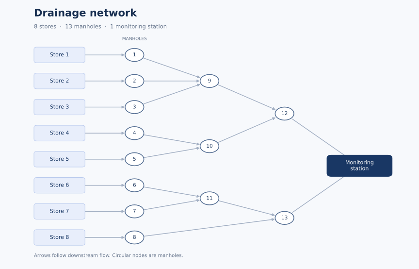

# Chemical Pollution Expert System

A university knowledge systems project that identifies candidate pollutants and traces their source through a drainage network. The static knowledge is modeled in **Protégé Frames**, and the interactive reasoning system is implemented in **CLIPS** using COOL classes, instances, functions, and a startup rule.

The example model contains **10 chemicals, 8 stores, 13 manholes, and one monitoring station**. It represents the simplified assumptions of the coursework.



## What it does

- Matches every supplied observation against chemical properties: pH, solubility, spectroscopy, colour, smell, specific gravity, and radioactivity.
- Narrows the possible stores by following their drainage routes and asking informative yes/no questions about manholes.
- Reports the remaining chemicals, their modeled hazards, and the source store. If routes cannot distinguish the remaining stores, it reports the ambiguity.
- Checks for broken drainage links and cycles, validates input, and exits cleanly when input ends.

## Run with CLIPS

Use [CLIPS 6.4](https://clipsrules.net/) and open its command environment in the repository root. No Python package is needed for this route.

```clips
(clear)
(load "clips/pollution.clp")
(reset)
(run)
```

If CLIPS starts in another directory, use the absolute path to `clips/pollution.clp` in the `load` command. For a new consultation, run `(reset)` and `(run)` again.

Enter measurement names separated by spaces. Names are case-sensitive: use `pH`, `solubility`, `spectrometry`, `colour`, `smell`, `specific_gravity`, and `radioactivity`. `spectroscopy` is also accepted as an alias for `spectrometry`. The program asks for values **in the order you entered the names**. Terminal prompts retain the original Greeklish wording.

| Measurement | Accepted values |
| --- | --- |
| `pH` | Number from 0 to 14 |
| `solubility` | `soluble`, `insoluble` |
| `spectrometry` / `spectroscopy` | `none`, or one or more of `carbon sulphur metal sodium` |
| `colour` | `red`, `white`, `none` |
| `smell` | `choking`, `vinegar`, `none` |
| `specific_gravity` | Number from 0.9 to 1.1 |
| `radioactivity` | `yes`, `no` |

`none` must be supplied by itself for spectroscopy. Measurements that are omitted remain unknown and do not filter candidates.

## Example consultations

The following files contain the input lines to enter after `(run)`. They are terminal input, not CLIPS source or batch command files.

| Input file | Measurements and inspection answers | Expected result |
| --- | --- | --- |
| [Radioactive metal](examples/01-radioactive-metal.txt) | Metal detected; radioactivity present | `rubidium_hydroxide`, `store_3`; no manhole questions |
| [Petrol](examples/02-petrol.txt) | Insoluble; gravity 0.95; `manhole_10`: yes, `manhole_5`: no | `petrol`, `store_4`; hazard `explosive` |
| [Strong acids](examples/03-strong-acids.txt) | pH 2; `manhole_13`: yes | `sulphuric_acid` or `hydrochloric_acid`, `store_7`; their modeled hazards |

For example, the complete input for the petrol case is:

```text
solubility specific_gravity
insoluble
0.95
yes
no
```

## Open the ontology

Use **Protégé Frames 3.5**, the version recorded in the original project. Open [ontology/pollution.pprj](ontology/pollution.pprj) and keep `pollution.pprj`, `pollution.pont`, and `pollution.pins` together in the same directory.

- `.pont`: class hierarchy, slots, and constraints.
- `.pins`: chemical, store, manhole, and station instances.
- `.pprj`: project configuration and editor layout.

This is a Frames project. Modern Protégé Desktop's OWL editor does not directly open this format. See the [official Frames file documentation](https://protegewiki.stanford.edu/wiki/PrF_UG_files_protege_files) for the three-file format and import instructions.

The CLIPS file embeds the converted classes and instances, so the reasoning system runs independently of Protégé. When editing the ontology, update the corresponding embedded static knowledge in `clips/pollution.clp` as well. See [model details](docs/model.md) and the [original ontology report](docs/ontology-report.pdf), with student identifiers removed.

## Automated checks

The optional test suite uses [clipspy](https://clipspy.readthedocs.io/), a Python binding to the real CLIPS engine. Install Python 3.10 or newer, then run from the repository root:

```bash
python -m venv .venv
```

Activate the environment:

```powershell
# Windows PowerShell
.venv\Scripts\Activate.ps1
```

```bash
# macOS / Linux
source .venv/bin/activate
```

```bash
python -m pip install -r requirements-test.txt
python -m unittest discover -s tests -v
```

The suite covers the three example consultations, all ten chemicals, pH and gravity boundaries, spectroscopy, input validation, incomplete input, invalid graphs, ambiguous sources, and additional stores with arbitrary instance names. It also checks that the Protégé instances match the embedded CLIPS instances.

## Project files

| Path | Purpose |
| --- | --- |
| [clips/pollution.clp](clips/pollution.clp) | Static knowledge and interactive CLIPS solver |
| [ontology/](ontology/) | Original Frames project, with portable filenames and corrected data |
| [docs/model.md](docs/model.md) | Model assumptions, class hierarchy, and search strategy |
| [docs/ontology-report.pdf](docs/ontology-report.pdf) | Greek coursework report, without student identifiers |
| [examples/](examples/) | Inputs for the three example consultations |
| [tests/test_pollution.py](tests/test_pollution.py) | Automated checks against the CLIPS engine |

## Contributors

- **Αριστοτέλης Κασσελούρης**
- **Μανώλης Αστραντίνης**

for the Knowledge Systems course.
